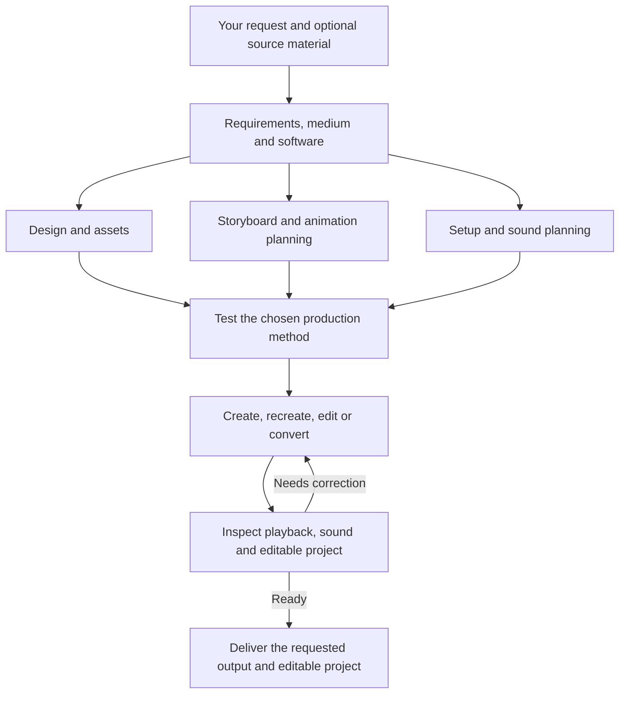

# AMEA — Anime Engineer Anything

**An open workflow for authoring editable anime animation with ChatGPT and Blender Grease Pencil.**

[](LICENSE)

[Quick start](#quick-start) · [Capabilities](#capabilities) · [Workflow](#workflow) · [Requirements](#requirements)

AMEA is **2D-only**. Depth comes from constructed perspective, foreshortening and parallax.

Start with a description, reference images, an existing project, or a video. AMEA supplies the skills and instructions for a ChatGPT session that can control the computer, work with files, and inspect the result.

## Quick start

### 1. Get AMEA

Clone the repository, or choose **Code → Download ZIP** on GitHub:

```bash
git clone https://github.com/KinshukAuthorities/AMEA.git
cd AMEA
```

### 2. Load the instructions

Give your ChatGPT session access to the repository and ask it to read [`skills/amea/SKILL.md`](skills/amea/SKILL.md). Keep the skill folders together.

Alternatively, load [`CHATGPT-AMEA.md`](CHATGPT-AMEA.md) as consolidated instructions. Keep the repository available if helper scripts are needed.

### 3. Make your request

```text
Use AMEA: [your request]
```

For a new prompt without medium or software choices, AMEA uses **authored drawn 2D in Blender Grease Pencil**. It follows explicit choices and preserves an existing project's medium/software. Attach source material when relevant; it is optional for original animation.

For example:

```text
Use AMEA: Create a 12-second 2D anime scene in Blender of a courier landing
on a rooftop, regaining balance, then looking toward the city. Use changing
drawn perspectives, expressive whole-body motion and wind in loose clothing.
Deliver a playable video and editable Grease Pencil project. Author the
drawings without image or video generation.
```

AMEA develops the prompt into design references, timed action and camera choices, reviewed key poses, breakdowns and finished native animation. You do not need to prescribe the production steps. The [drawn-anime guide](skills/amea/references/drawn-anime.md) addresses construction, support, occlusion and secondary motion; the [Blender 2D guide](skills/amea/references/blender-2d.md) explains the native workflow and optional bulk contour helper. These remain creative production workflows, not a one-command guarantee of a particular artistic standard.

[Canonical workflow selection](skills/amea/references/workflow-selection.md) is the routing authority. The current drawn workflow is the default across creation, reconstruction and new 2D motion edits. Generated-frame, tracing and cutout production are explicit alternatives, not automatic fallbacks. The consolidated instructions are generated from these same sources; use files from one current bundle rather than mixing old copied prompts with current skills.

## Capabilities

The default 2D workflow combines:

- **Character construction across views:** consistent facial features, profiles, elevated views, anatomy and costume coverage.
- **Whole-body performance:** anticipation, weight transfer, travelling action, contact and recovery, with purposeful camera framing.
- **Editable drawings:** authored contours transferred into native Grease Pencil layers and timed exposures.
- **Visual review and repair:** inspect actual drawings and consecutive motion, correct visible defects, and retest the affected interval.

AMEA provides production guidance and transport tools. Drawing quality and animation quality must be demonstrated in the resulting artwork; successful exports and automated checks do not establish a professional artistic standard.

| Task | What AMEA does |
| --- | --- |
| [Create](skills/amea-create/SKILL.md) | Develop an original animation from your request and optional references. |
| [Recreate](skills/amea-recreate/SKILL.md) | Rebuild supplied footage with the appearance, action, and timing you want to preserve. |
| [Edit](skills/amea-edit/SKILL.md) | Apply requested changes, insert material, or edit timing, style, framing, text, effects, and sound. |
| [Convert to 2D](skills/amea/SKILL.md) | Recreate supplied footage as editable 2D animation. |

For faithful recreation, it follows the source. For edits, it preserves unaffected content and carries persistent changes into later scenes. Sound is handled according to the request and context. You do not need to restate continuity, synchronization, review, or export.

## Workflow



Independent work can run in parallel when the host supports it. The agent reviews actual playback and frames, corrects visible issues, and retests before delivery. The work stays within your request, including when you ask only for planning or a rough version.

## Requirements

- A ChatGPT session with file, visual-inspection and selected-software execution tools. Native scripting/CLI can handle supported work without keeping an editor window open; interactive editing needs actual computer control.
- Image, video or speech generation capabilities only when the selected production method uses them. Editable 2D contour production does not require a generation service.
- Blender for the default drawn-2D route, or the software explicitly selected or inherited from your project. A genuine unresolved choice outside the default may require clarification.
- Python 3.10+ for the optional helpers; FFmpeg and FFprobe for helper-based media processing.

[`requirements.txt`](requirements.txt) is the single dependency file. Its installable baseline supports the image helpers; comments identify optional model dependencies and official setup links. The agent installs only what the chosen workflow needs. Editors, model weights, libraries, and user projects are not bundled.


For an explicitly selected generation method, an unavailable required model or blocked service prompts a choice of alternatives before that method changes. This does not block default authored 2D, which needs no generator account or model download. See [asset generation](skills/amea/references/asset-generation.md) and [setup](skills/amea/references/runtime.md).

AMEA is a skill and helper package. The connected tools and production work determine the achievable result; instructions alone do not provide those capabilities.

## License

[MIT](LICENSE). External tools, models, and supplied assets retain their own licenses and terms.

AMEA’s MIT License applies to its authored code and documentation. Third-party tools, services, models, and media remain subject to their own licenses, terms, and rights; AMEA grants no third-party license, key, or activation entitlement. Users are responsible for ensuring that their use of tools and their creation, recreation, uploading, and distribution of content are authorized or otherwise permitted by applicable law. Recreating, modifying, or converting copyrighted material does not itself grant permission to use or distribute it. This notice does not amend the MIT License or any third-party license.
