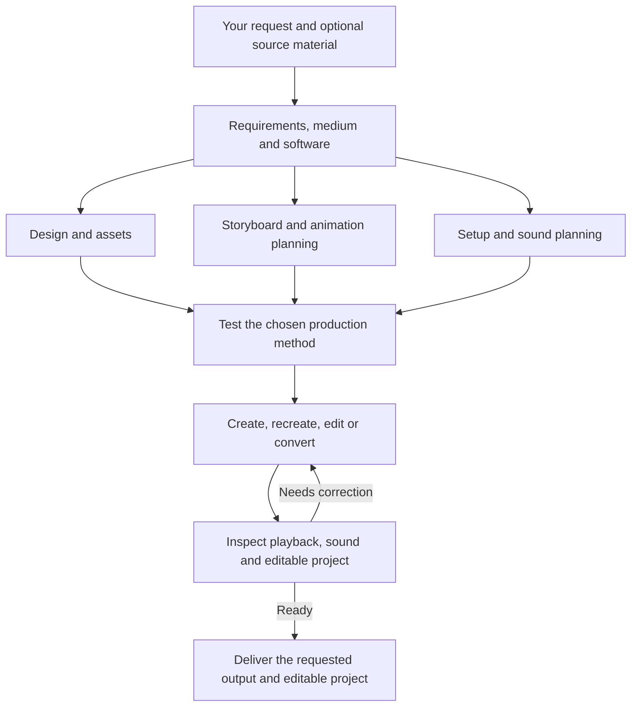

# AMEA — Anime Engineer Anything

**Create, recreate, edit, and convert anime videos with ChatGPT and your chosen software.**

[](LICENSE)

[Quick start](#quick-start) · [Capabilities](#capabilities) · [Workflow](#workflow) · [Requirements](#requirements)

Start with a description, reference images, an existing project, or a video. AMEA supplies the skills and instructions for a ChatGPT session that can control the computer, work with files, and inspect the result.

## Quick start

### 1. Get AMEA

Clone the repository, or choose **Code → Download ZIP** on GitHub:

```bash
git clone https://github.com/KinshukAuthorities/AMEA.git
cd AMEA
```

### 2. Load the instructions

Give your ChatGPT session access to the repository and ask it to read [`skills/amea/SKILL.md`](skills/amea/SKILL.md). Keep the skill folders together.

Alternatively, load [`CHATGPT-AMEA.md`](CHATGPT-AMEA.md) as consolidated instructions. Keep the repository available if helper scripts are needed.

### 3. Make your request

```text
Use AMEA: [your request]
```

Attach any source material and include your 2D/3D and software preferences when known. AMEA reuses established choices and asks together for missing essential preferences.

## Capabilities

| Task | What AMEA does |
| --- | --- |
| [Create](skills/amea-create/SKILL.md) | Develop an original animation from your request and optional references. |
| [Recreate](skills/amea-recreate/SKILL.md) | Rebuild supplied footage with the appearance, action, and timing you want to preserve. |
| [Edit](skills/amea-edit/SKILL.md) | Apply requested changes, insert material, or edit timing, style, framing, text, effects, and sound. |
| [Convert to 2D or 3D](skills/amea/SKILL.md) | Recreate a source video in the requested animation format and apply your specified changes. |

For faithful recreation, it follows the source. For edits, it preserves unaffected content and carries persistent changes into later scenes. Sound is handled according to the request and context. You do not need to restate continuity, synchronization, review, or export.

## Workflow



Independent work can run in parallel when the host supports it. The agent reviews actual playback and frames, corrects visible issues, and retests before delivery. The work stays within your request, including when you ask only for planning or a rough version.

## Requirements

- A ChatGPT session with the computer, file, visual-inspection, and generation capabilities needed for the task.
- Your selected animation software. AMEA asks if you have not already chosen it.
- Python 3.10+ for the optional helpers; FFmpeg and FFprobe for helper-based media processing.

[`requirements.txt`](requirements.txt) is the single dependency file. Its installable baseline supports the image helpers; comments identify optional model dependencies and official setup links. The agent installs only what the chosen workflow needs. Editors, model weights, libraries, and user projects are not bundled.

For new 3D assets, **TRELLIS.2 is the preferred starting point** when suitable. The agent uses your supplied asset images or creates missing references, then tries the [official hosted generator](https://huggingface.co/spaces/microsoft/TRELLIS.2) where available.

If the required model is unavailable or online generation is blocked, the agent explains the blocker and asks you to choose the next route. Choices can include returning generated assets from prepared images, setting up local generation, or selecting another suitable method. It waits for that choice before proceeding with an alternative. See [asset generation](skills/amea/references/asset-generation.md) and [setup](skills/amea/references/runtime.md).

AMEA is a skill and helper package. The connected tools and production work determine the achievable result; instructions alone do not provide those capabilities.

## Development

Install helper dependencies in an isolated environment and run the checks:

```bash
python -m pip install -r requirements.txt
python -m unittest discover -s tests -v
```

Blender/FFmpeg integration tests run when those tools are available. Regenerate the consolidated instructions and the lightweight `../AMEA.zip` with:

```bash
python tools/build_package.py
```

## License

[MIT](LICENSE). External tools, models, and supplied assets retain their own licenses and terms.
