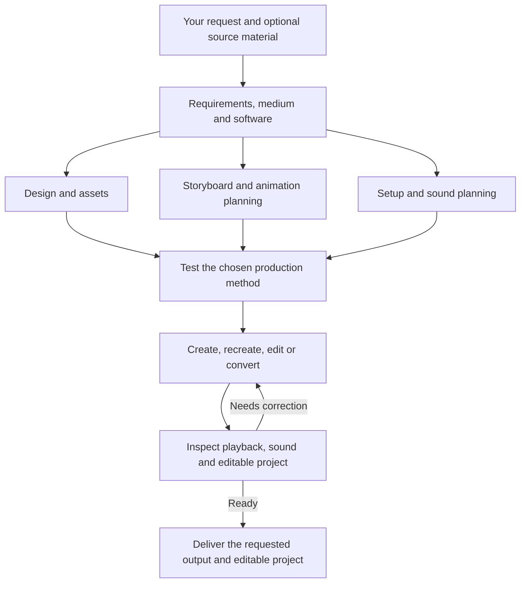

# AMEA — Animation Engineer Anything

**An open workflow for editable animation with ChatGPT and Blender.**

[](LICENSE)

[Quick start](#quick-start) · [Capabilities](#capabilities) · [Workflow](#workflow) · [Requirements](#requirements)

Previously AI agents, video/image generation tools were unreliable cause it dont keep track of scenes,characters,environment when generating clips, also when need to edit some part of a clip, the video generation regenerates the whole clip entirely loosing previous context.
AMEA solves it , it provides AI AGENTS guidance, tools and skills which help agent itself create animations in blender, which is easily editable, also AI dosent looses its context the scene progresses in continous flow.


## Showcases

### Stickman Animation  ( just 1 prompt ) 

https://github.com/user-attachments/assets/d0e38c69-f001-4be6-9d3b-f005d98415f4

## Quick start

### 1. Get AMEA

Clone the repository, or choose **Code → Download ZIP** on GitHub:

```bash
git clone https://github.com/KinshukAuthorities/AMEA.git
cd AMEA
```

### 2. Load the instructions

Give your ChatGPT session access to the repository and ask it to read all the skills.

### 3. Make your request

```text
Use AMEA: [your request]
```

For example:

```text
Use AMEA to Create a 30 seconds epic stickman fighting with sound effects, intense combat, fast paced movements and aura
```

AMEA develops the prompt into design references, timed action and camera choices, reviewed key poses, breakdowns and finished native animation. You do not need to prescribe the production steps. The [drawn-anime guide](skills/amea/references/drawn-anime.md) addresses construction, support, occlusion and secondary motion; the [Blender 2D guide](skills/amea/references/blender-2d.md) explains the native workflow and optional bulk contour helper. These remain creative production workflows, not a one-command guarantee of a particular artistic standard.

[Canonical workflow selection](skills/amea/references/workflow-selection.md) is the routing authority. The current drawn workflow is the default across creation, reconstruction and new 2D motion edits. Generated-frame, tracing and cutout production are explicit alternatives, not automatic fallbacks. The consolidated instructions are generated from these same sources; use files from one current bundle rather than mixing old copied prompts with current skills.

## Capabilities

The default 2D workflow combines:

- **Character construction across views:** consistent facial features, profiles, elevated views, anatomy and costume coverage.
- **Whole-body performance:** anticipation, weight transfer, travelling action, contact and recovery, with purposeful camera framing.
- **Editable drawings:** authored contours transferred into native Grease Pencil layers and timed exposures.
- **Visual review and repair:** inspect actual drawings and consecutive motion, correct visible defects, and retest the affected interval.

AMEA provides production guidance, tools and skills. Drawing quality and animation quality must be demonstrated in the resulting artwork and depends on which agent you use.

| Task | What AMEA does |
| --- | --- |
| [Create](skills/amea-create/SKILL.md) | Develop an original animation from your request. |
| [Recreate](skills/amea-recreate/SKILL.md) | Rebuild supplied footage preserving all details or as requested. |
| [Edit](skills/amea-edit/SKILL.md) | Apply requested changes, insert material, or edit timing, style, framing, text, effects, and sound. |


## Workflow



Independent work can run in parallel when the host supports it. The agent reviews actual playback and frames, corrects visible issues, and retests before delivery. The work stays within your request, including when you ask only for planning or a rough version.

## Requirements

- A ChatGPT session and Blender.

[`requirements.txt`](requirements.txt) is the single dependency file. Its installable baseline supports the image helpers; comments identify optional model dependencies and official setup links. The agent installs only what the chosen workflow needs. Editors, model weights, libraries, and user projects are not bundled.


For an explicitly selected generation method, an unavailable required model or blocked service prompts a choice of alternatives before that method changes. This does not block default authored 2D, which needs no generator account or model download. See [asset generation](skills/amea/references/asset-generation.md) and [setup](skills/amea/references/runtime.md).

AMEA is a skill and helper package. The connected tools and production work determine the achievable result; instructions alone do not provide those capabilities.

## License

[MIT](LICENSE). External tools, models, and supplied assets retain their own licenses and terms.

AMEA’s MIT License applies to its authored code and documentation. Third-party tools, services, models, and media remain subject to their own licenses, terms, and rights; AMEA grants no third-party license, key, or activation entitlement. Users are responsible for ensuring that their use of tools and their creation, recreation, uploading, and distribution of content are authorized or otherwise permitted by applicable law. Recreating, modifying, or converting copyrighted material does not itself grant permission to use or distribute it. This notice does not amend the MIT License or any third-party license.
