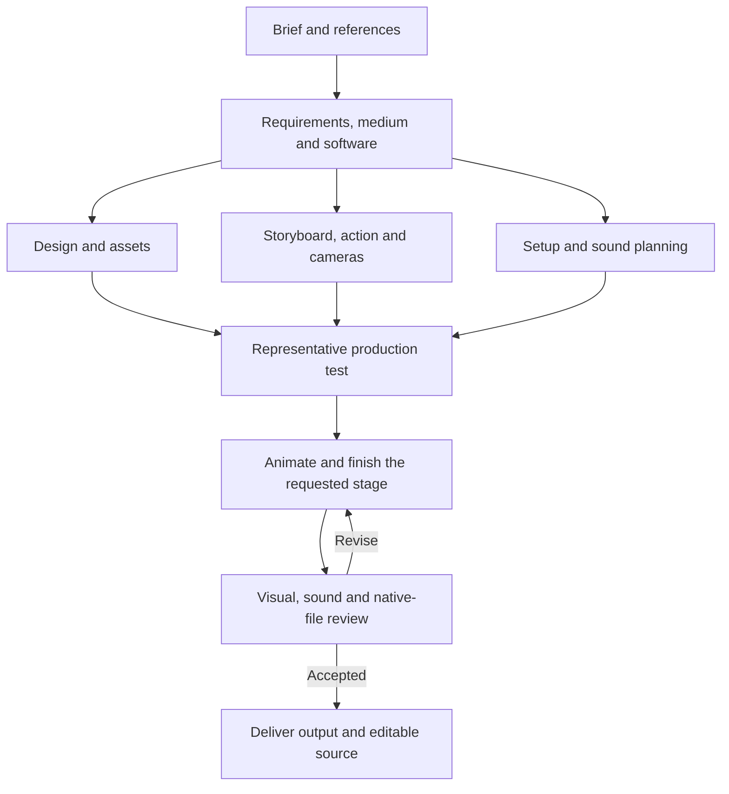

# AMEA — Anime Engineer Anything

**Create, reconstruct, and edit anime animation with ChatGPT and your chosen production software.**

[](LICENSE)
[](#what-you-can-do)

[Quick start](#quick-start) · [Workflow](#how-it-works) · [Requirements](#requirements) · [Guides](#guides) · [Development](#development)

AMEA gives a computer-capable ChatGPT session a coordinated animation workflow: design references, assets, storyboards, motion, cameras, sound, visual review, and editable delivery. Start from a brief, source footage, reference images, or existing work.

This repository contains **skills, production instructions, and optional Python helpers**. The session must already have access to the computer, files, visual inspection, and any generation tools the production needs.

## Quick start

### 1. Get the package

Clone this repository, or use GitHub's **Code → Download ZIP**:

```bash
git clone https://github.com/KinshukAuthorities/AMEA.git
cd AMEA
```

### 2. Load the instructions

Give your capable ChatGPT session access to the folder and ask it to read [`skills/amea/SKILL.md`](skills/amea/SKILL.md). Keep all five skill folders together so the linked instructions remain available.

For a single-document route, provide [`CHATGPT-AMEA.md`](CHATGPT-AMEA.md) as instructions. Keep the repository accessible when the agent needs its helper scripts.

### 3. Describe the animation

```text
Use AMEA: [your request]
```

Include your 2D/3D and software preferences when known. AMEA reuses established choices and asks together for missing essential preferences. References and source footage are optional for original work.

The workflow handles continuity, preservation of unaffected content, synchronized sound, review, and export by default. Routine production decisions and internal corrections do not require repeated prompting.

## What you can do

| Task | Workflow |
| --- | --- |
| Create original animation | Develop the brief into designs, timed staging, changing poses, expressions, cameras, and contextual sound. |
| Reconstruct source animation | Analyze the supplied motion, appearance, timing, text, and sound; preserve evidence and uncertainty. |
| Edit existing work | Change motion or design, insert material, carry persistent changes forward, or adjust timing, framing, style, text, and effects. |
| Produce in 2D or 3D | Use drawing-based or rigged workflows appropriate to the brief and selected editor, retaining useful native source. |

Speech and narration are optional. Traditional 2D work does not require a 3D mesh or a downloaded character model. New 3D assets can use supplied images or newly created references; **TRELLIS.2 is the preferred first candidate**, with other methods available when better suited to the task. See [asset generation](skills/amea/references/asset-generation.md) for the [official hosted demo](https://huggingface.co/spaces/microsoft/TRELLIS.2), export, and local alternatives.

## How it works



Independent work runs in parallel when the host provides suitable workers or asynchronous tools. A coordinator maintains one timeline, shared references, dependencies, and revisions. Native files have one writer, and desktop input has one owner at a time.

The agent tests the actual production method before scaling. It checks intended energy, pacing, expression, staging, and camera readability in motion. Planning-only and rough-only requests stop at their requested stage; finishing-only edits preserve their scope.

**Visual review comes first.** The agent inspects real playback and consecutive frames, corrects native causes of visible defects, and retests the affected interval. Numerical audits and valid exports support this review. They do not establish likeness, convincing acting, or correct deformation.

The acceptance workflow connects requirements to current evidence and checks declared frame coverage. Internal revisions aim for a strong first delivery; the package does not guarantee a particular artistic result. See the [quality audit](QUALITY-AUDIT.md) for remaining limits.

## Requirements

| Component | When needed |
| --- | --- |
| ChatGPT with verified computer and visual tools | Production, application control, and perceptual review. Image or speech generation requires its own available capability. |
| Your chosen animation software | Native drawing, scene editing, rigging, or finishing. Krita and Blender have optional helper implementations. |
| Python 3.10+ | Running the repository's helpers. Reading the instructions does not require Python. |
| FFmpeg and FFprobe | Helper-based media extraction, assembly, and export checks. |
| Optional generation backend | Only when the production needs it. Hosted generation does not require a local inference stack. |

The agent should inspect installed tools, reuse compatible environments, and install only missing requirements for the selected route. Libraries, editors, model weights, and user projects are **not bundled**.

- [`requirements.txt`](requirements.txt): dependency catalog and official tool/model links.
- [`requirements-2d.txt`](requirements-2d.txt): small image-helper profile.
- [`requirements-hunyuan.txt`](requirements-hunyuan.txt): optional local fallback profile.
- [Runtime guide](skills/amea/references/runtime.md): environment selection and capability checks.

## Guides

| Guide | Purpose |
| --- | --- |
| [AMEA entrypoint](skills/amea/SKILL.md) | Intent, preferences, routing, and delivery. |
| [Original creation](skills/amea-create/SKILL.md) | Animation from a brief and optional references. |
| [Reconstruction](skills/amea-recreate/SKILL.md) | Source evidence, fidelity, and timing. |
| [Editing](skills/amea-edit/SKILL.md) | Local changes, insertions, persistent state, and preservation. |
| [3D production](skills/amea-3d/SKILL.md) | Geometry, materials, rigging, performance, and rendering. |
| [Parallel workers](skills/amea/references/parallel-production.md) | Work ownership, dependencies, and resource-aware scheduling. |
| [First-delivery acceptance](skills/amea/references/first-delivery.md) | Requirement coverage, method tests, and the delivery gate. |
| [Visual review and repair](skills/amea/references/visual-review-and-repair.md) | Detecting, correcting, and retesting visible failures. |

## Development

Install the helper test dependencies in an isolated environment, then run:

```bash
python -m pip install -r requirements-2d.txt
python -m unittest discover -s tests -v
```

Tests cover evidence integrity, timing, acceptance records, packaging, and safe resuming. Blender/FFmpeg integration checks run when the relevant tools are available; otherwise those checks are skipped. Tests do not certify artistic quality.

Regenerate the consolidated instructions and the lightweight archive:

```bash
python tools/build_package.py
```

The archive is written to `../AMEA.zip` and excludes projects, environments, model downloads, and caches. For the schema and commands of a helper, use its linked guide or `python tools/<helper>.py --help`.

## License

[MIT](LICENSE). External software, dependencies, models, weights, and supplied assets retain their own licenses and terms.
